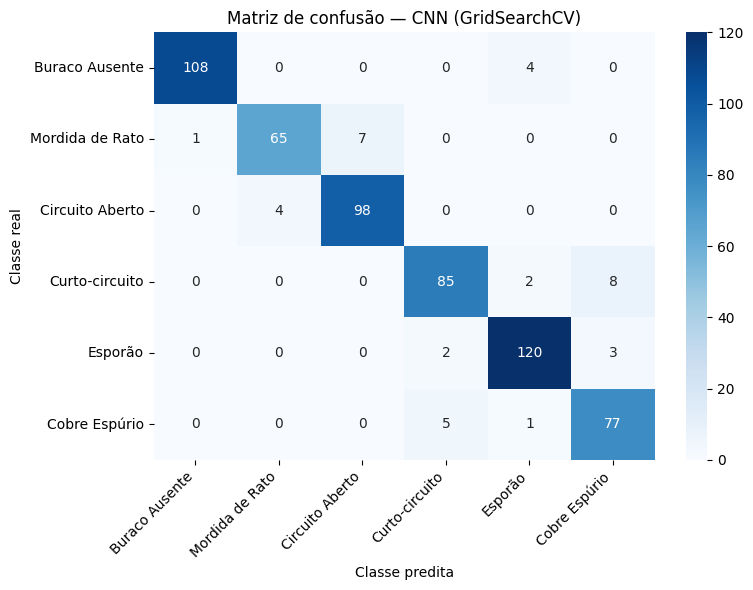
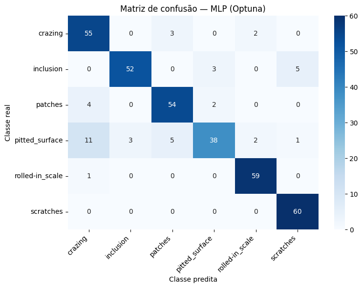
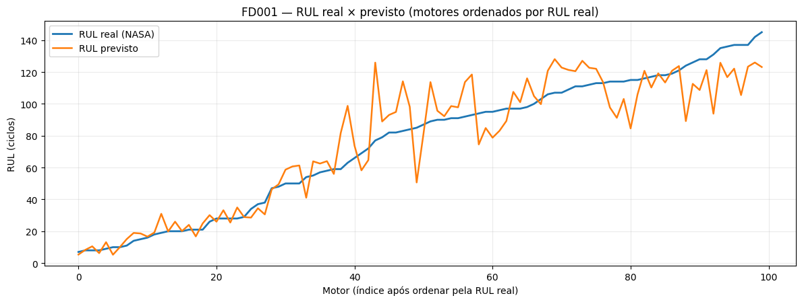

# Aprendizado de Máquina aplicado à inspeção industrial e prognóstico de falhas

> **Projeto acadêmico — PPGEP/UFPE**  
> Três estudos, seis classificadores, otimização de hiperparâmetros e previsão de vida útil remanescente.

Este repositório reúne **notebooks executados, metodologia, resultados, figuras e relatórios técnicos em Markdown**. O conteúdo foi organizado para leitura diretamente no GitHub e para permitir que os experimentos sejam examinados e reproduzidos, respeitando as dependências e o acesso aos datasets originais.

## Resultados em destaque

| Estudo | Problema | Melhor configuração selecionada | Avaliação final |
|---|---|---|---|
| **PCB** | Classificação de 6 defeitos em **recortes de regiões anotadas** | CNN 2D · GridSearchCV | **93,73% accuracy · 93,36% F1 macro** · 590 recortes |
| **NEU** | Classificação de 6 defeitos em imagens de aço | MLP (HOG) · Optuna | **88,33% accuracy · 87,98% F1 macro** · 360 imagens |
| **NASA FD001** | Regressão de vida útil remanescente de motores turbofan | LSTM 2 camadas · Optuna TPE + Hyperband | **RMSE 14,52 ciclos · MAE 10,77 ciclos** · 100 motores |

> **Interpretação:** resultados de três tarefas distintas. Não se deve comparar diretamente a acurácia de PCB e NEU como medida de dificuldade intrínseca, nem comparar acurácia de classificação com RMSE de regressão.

## Leia os estudos

| Dataset | Relatório técnico | Notebook executado |
|---|---|---|
| PCB (placas de circuito impresso) | [01 · Classificação PCB](docs/01-pcb.md) | [PCB_classificacao.ipynb](notebooks/PCB_classificacao.ipynb) |
| NEU (superfícies de aço) | [02 · Classificação NEU](docs/02-neu.md) | [NEU_classificacao.ipynb](notebooks/NEU_classificacao.ipynb) |
| NASA C-MAPSS FD001 | [03 · Regressão de RUL](docs/03-nasa-fd001.md) | [NASA_FD001_regressao.ipynb](notebooks/NASA_FD001_regressao.ipynb) |

**Material de apoio:** [metodologia, algoritmos e métricas](docs/04-metodologia.md) · [síntese comparativa](docs/05-sintese.md) · [apresentação acadêmica (.pptx)](apresentacao/VP2_apresentacao.pptx).

## Visualização rápida dos experimentos

| PCB — matriz de confusão da CNN | NEU — matriz de confusão da MLP |
|---|---|
|  |  |



**Leitura dos gráficos:** a diagonal das matrizes corresponde aos acertos por classe. No gráfico NASA, as diferenças entre RUL verdadeiro e previsto mostram erros de regressão, expressos em ciclos. As figuras foram extraídas dos resultados registrados nos notebooks.

## Protocolo experimental, em síntese

1. **EDA:** distribuição de classes ou trajetórias, exemplos, variabilidade e inspeção de sensores.
2. **Pré-processamento:** imagens 64 × 64; pixels para CNN; HOG 288 para modelos clássicos. No NASA, seleção de 14 sensores, normalização e RUL com clipping em 130 ciclos apenas nos alvos de treinamento.
3. **Separação de dados:** PCB com agrupamento por imagem de origem, NEU com 360 imagens reservadas para teste, NASA com divisão por identidade do motor (80 treino, 20 validação, 100 teste oficial).
4. **Seleção:** GridSearchCV × Optuna com validação cruzada nos classificadores; Optuna TPE + Hyperband para modelos recorrentes do NASA.
5. **Avaliação final:** accuracy, precision, recall, F1 macro e matrizes de confusão para classificação; RMSE, MAE e NASA Score para RUL.

## Organização dos arquivos

```text
.
├── README.md
├── COMO_PUBLICAR.md
├── requirements.txt
├── docs/
│   ├── 01-pcb.md
│   ├── 02-neu.md
│   ├── 03-nasa-fd001.md
│   ├── 04-metodologia.md
│   └── 05-sintese.md
├── notebooks/
│   ├── PCB_classificacao.ipynb
│   ├── NEU_classificacao.ipynb
│   └── NASA_FD001_regressao.ipynb
├── assets/figuras/              # imagens extraídas dos notebooks e diagramas
└── apresentacao/
    └── VP2_apresentacao.pptx
```

## Como executar

### 1. Instalar dependências

```bash
python -m venv .venv
# Linux/macOS:
source .venv/bin/activate
# Windows (PowerShell):
# .venv\Scripts\Activate.ps1
pip install -r requirements.txt
jupyter lab
```

Os notebooks foram elaborados em ambiente científico do tipo **Kaggle/Google Colab** e podem conter células específicas dessas plataformas. Dependendo do ambiente e das versões das bibliotecas, poderão ser necessários ajustes. A lista em `requirements.txt` documenta pacotes utilizados, **não é um lockfile de versões reproduzidas**.

### 2. Obter os datasets de fontes apropriadas

- PCB: [PCB Defects — Kaggle](https://www.kaggle.com/datasets/akhatova/pcb-defects), utilizado no notebook por `kagglehub`.
- NEU: [NEU Surface Defect Database — Kaggle](https://www.kaggle.com/datasets/kaustubhdikshit/neu-surface-defect-database), utilizado por `kagglehub`.
- NASA: [C-MAPSS, NASA Prognostics Data Repository](https://ti.arc.nasa.gov/tech/dash/groups/pcoe/prognostic-data-repository/) — arquivos FD001. O notebook busca `train_FD001.txt`, `test_FD001.txt` e `RUL_FD001.txt` e inclui uma rota alternativa de download.

Os datasets **não são redistribuídos neste repositório**; respeite as condições de acesso e uso das fontes originais.

### 3. Executar os notebooks

Execute um notebook por vez, seguindo a ordem das células. Algumas buscas de hiperparâmetros são computacionalmente intensivas; o NASA inclui trials de redes recorrentes e pode exigir ambiente com aceleração. Os resultados documentados pertencem às execuções originais, sem promessa de reprodutibilidade numérica exata em hardware/versões diferentes.

## Decisões metodológicas e limitações

- **PCB:** a classificação é feita sobre **recortes provenientes de anotações XML**, não sobre placas completas sem localização prévia. Isso constitui uma tarefa válida de classificação de regiões de interesse, mas **não comprova capacidade de detecção autônoma na placa inteira**.
- **NEU:** a CNN obteve **90,21% na CV**, mas apenas **78,89% no teste**; a diferença sugere fragilidade de generalização ou mudança de distribuição, sem identificar isoladamente a causa.
- **NASA:** a LSTM foi a melhor configuração **entre as efetivamente exploradas**; a busca não equivale a uma comparação exaustiva e controlada entre LSTM, GRU e SimpleRNN. O limite de RUL usado no treinamento pode reduzir a precisão em motores com vida remanescente muito elevada.
- **GridSearchCV × Optuna:** os espaços e orçamentos de busca não foram rigorosamente iguais, portanto diferenças de tempo não comprovam superioridade absoluta do otimizador.

## Fonte dos resultados e escopo

Os valores, tabelas e figuras desta documentação foram adaptados **a partir das saídas dos três notebooks finais já executados**. Este repositório é uma organização para publicação e leitura no GitHub; **nenhum novo treinamento foi executado para gerar este material**. Não há, neste pacote, licença de redistribuição atribuída aos datasets ou autorização presumida para conteúdos de terceiros.

## Referências

Consulte as referências bibliográficas completas nos relatórios [PCB](docs/01-pcb.md), [NEU](docs/02-neu.md) e [NASA](docs/03-nasa-fd001.md). Documentação metodológica reunida em [Metodologia](docs/04-metodologia.md).

## Uso de Inteligência Artificial

O uso do ChatGPT esteve presente no desenvolvimento desse estudo e na revisão dos códigos, no esclarecimento de conceitos técnicos, no apoio à análise dos resultados e na revisão do texto. As recomendações e sugestões foram avaliadas criticamente pelo autor. O autor assume total responsabilidade pelas informações e conclusões apresentadas. 
