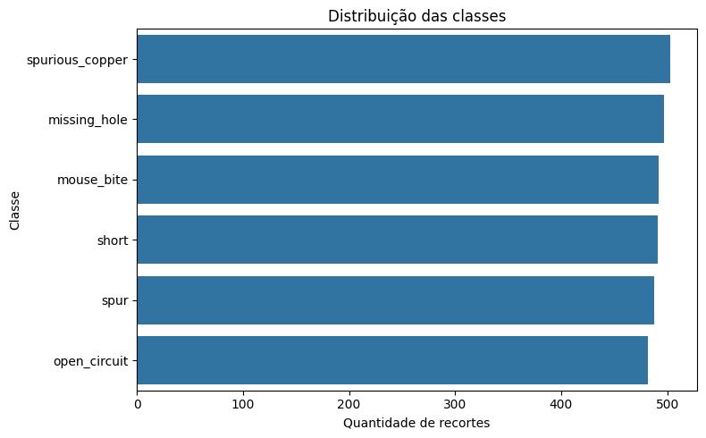
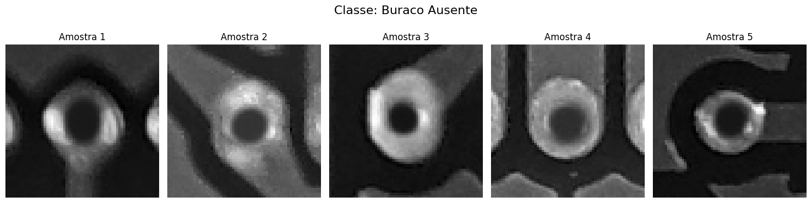
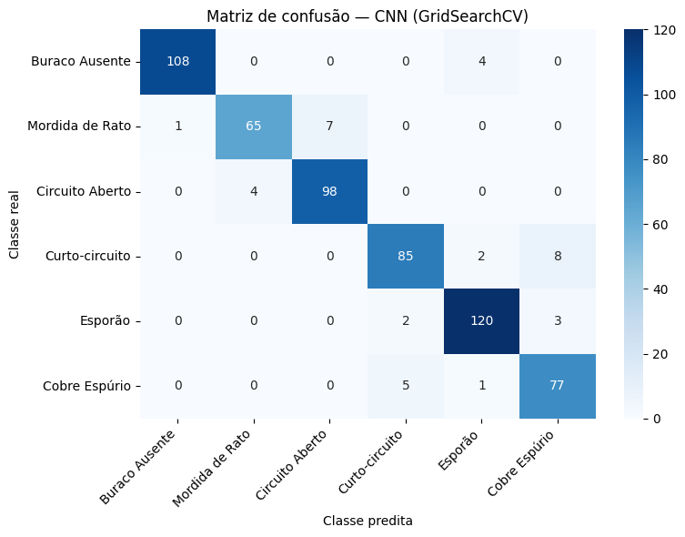
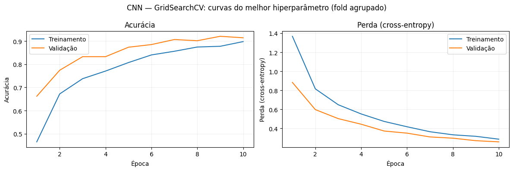

# PCB — Classificação de defeitos em placas de circuito impresso

[← Visão geral](../README.md) · [Metodologia e métricas](04-metodologia.md) · [Notebook executado](../notebooks/PCB_classificacao.ipynb)

**Problema:** classificação de seis tipos de defeito a partir de **regiões de interesse extraídas de anotações XML**. Resultados são do notebook final executado; não foi realizado novo treinamento para esta documentação.

## 1. O problema industrial e a estrutura dos arquivos

Placas de circuito impresso contêm trilhas condutoras, vias e regiões metálicas cuja integridade é fundamental para a continuidade elétrica. Pequenas imperfeições podem interromper circuitos, produzir curtos ou introduzir cobre indesejado. O PCB Defect Dataset reúne **1.386 imagens**, das quais **693 estão em posição normal** e **693 são versões rotacionadas**, com seis categorias: *missing hole* (furo ausente), *mouse bite* (mordida de rato), *open circuit* (circuito aberto), *short* (curto-circuito), *spur* (esporão) e *spurious copper* (cobre espúrio).

O notebook realiza leitura de imagens e anotações, constrói um `DataFrame` com classe, imagem original e coordenadas, e extrai **2.953 recortes de regiões defeituosas**. Esta distinção é decisiva: o total de imagens originais não corresponde ao número de amostras finais usadas na classificação. Várias regiões anotadas podem ser extraídas de uma mesma imagem.

**Alinhamento com o enunciado:** o guia da avaliação final disponibilizada pelo professor informa que o PCB deveria envolver identificação de defeitos na placa **sem adotar as imagens anotadas**. O código analisado, entretanto, utiliza anotações XML para recortar regiões. Assim, o resultado registrado mede **classificação de recortes de defeitos**, não localização autônoma de defeitos em placas completas. Essa divergência de escopo foi alinhada diretamente com o professor; uma extensão natural futura é treinar e avaliar uma etapa independente de localização ou detecção na imagem integral.

## 2. Análise exploratória: distribuição e representação das classes

A análise exploratória identifica **2.953 recortes** distribuídos de modo aproximadamente equilibrado: *spurious copper* 503 (17,03%), *missing hole* 497 (16,83%), *mouse bite* 492 (16,66%), *short* 491 (16,63%), *spur* 488 (16,53%) e *open circuit* 482 (16,32%). A razão entre a classe maior e a menor é de somente **1,04**, sugerindo ausência de desbalanceamento acentuado no nível dos recortes.

*Figura 1. Distribuição de recortes por classe, extraída da análise exploratória executada no notebook PCB.*

*Figura 2. Exemplos de regiões processadas. Pequenas estruturas geométricas e diferenças locais de contorno explicam a importância do detalhamento visual.*

O balanceamento observado não elimina diferenças de dificuldade. Classificar um **furo ausente** envolve sinais visuais distintos dos necessários para distinguir pequenas deformações no cobre ou interrupções discretas de uma trilha. Além disso, amostras geradas a partir da mesma imagem de origem não são necessariamente independentes.

## 3. Pré-processamento, prevenção de vazamento e divisão dos dados

As regiões anotadas são recortadas, redimensionadas para **64 × 64 pixels** e convertidas em intensidades normalizadas por `pixel/255`, produzindo tensores `(2953, 64, 64, 1)` para CNN (Convolutional Neural Networks). A divisão resulta em **2.363 recortes de treinamento** e **590 de teste**. Os modelos MLP, SVM, RF, AD e NB utilizam a transformação HOG (Histogram of Oriented Gradients) de dimensão **288**; a padronização para MLP/SVM é realizada no pipeline de treinamento, evitando ajustá-la com registros do teste.

O notebook adota uma separação **agrupada por imagem de origem** e emprega `StratifiedGroupKFold` na validação cruzada. Esse detalhe importa mais do que uma separação aleatória ingênua: se recortes diferentes provenientes da mesma placa fossem distribuídos entre treinamento e validação, detalhes específicos da imagem poderiam ser reutilizados e inflar artificialmente as estimativas de desempenho.

## 4. Treinamento e comparação de hiperparâmetros

Os seis classificadores foram submetidos a **GridSearchCV e Optuna**, sempre com três folds na validação cruzada. No caso da CNN, a arquitetura emprega duas convoluções (32 e 64 filtros), pooling configurável, `Flatten`, `Dropout`, camada densa de 128 neurônios e saída `Dense(6, softmax)`. A perda é *sparse categorical cross-entropy*, o otimizador é Adam e o treino da grade considerada utiliza 10 épocas. Na MLP, a rede densa é implementada com TensorFlow/Keras e SciKeras, recebendo as features HOG padronizadas.

A tabela mostra a **acurácia CV** de cada otimizador, seus tempos e o método selecionado. O tempo inclui a busca e o reajuste final, conforme os registros do notebook. Valores arredondados em minutos; tempos mostrados como ~0 indicam arredondamento de medições muito curtas.

| Algoritmo | GS: acurácia CV | Tempo GS (min) | Optuna: acurácia CV | Tempo Optuna (min) | Selecionado |
|---|---:|---:|---:|---:|---|
| CNN | 91,66% | 7,03 | 90,05% | 2,66 | GridSearchCV |
| MLP | 85,27% | 18,37 | 85,23% | 4,42 | Optuna |
| RF | 85,36% | 3,00 | 86,03% | 10,83 | Optuna |
| AD | 63,99% | 1,01 | 61,79% | 0,06 | GridSearchCV |
| SVM | 87,13% | 0,27 | 87,09% | 0,16 | Optuna |
| NB | 64,95% | ~0 | 64,95% | ~0 | GridSearchCV |

Na **CNN**, o GS venceu na validação por 1,61 ponto percentual, embora tenha levado mais tempo. Na **MLP**, a acurácia de validação praticamente empatou; a configuração Optuna foi selecionada por requerer menos tempo na execução registrada. No **RF**, o Optuna encontrou resultado de validação ligeiramente superior, mas com custo computacional bem maior. O **SVM** teve diferença mínima entre métodos; aqui a seleção por menor tempo é plausível. O **NB** praticamente não se beneficia de uma busca extensa porque possui poucos hiperparâmetros relevantes no arranjo empregado.

## 5. Avaliação final: acurácia, precisão, recall, F1 e confusão

Antes dos resultados, é útil explicar as métricas. **Acurácia** é a razão entre classificações corretas e o total de amostras. **Precisão** responde: entre as imagens preditas como determinada classe, quantas realmente pertencem a ela? **Recall** responde: entre as imagens daquela classe, quantas foram recuperadas? O **F1-score** é a média harmônica entre precisão e recall: `F1 = 2·P·R/(P+R)`. Na **média macro**, calcula-se primeiro a métrica para cada classe e depois se toma uma média aritmética, sem privilegiar classes maiores. Na **média ponderada**, o peso de cada classe é proporcional à quantidade de amostras. A **matriz de confusão** registra, por linha, classes reais e, por coluna, classes preditas.

| Modelo escolhido | Acurácia teste | Precisão macro | Recall macro | F1 macro |
|---|---:|---:|---:|---:|
| CNN · GS | **93,73%** | **93,50%** | **93,30%** | **93,36%** |
| SVM · Optuna | 89,83% | 89,23% | 89,99% | 89,48% |
| MLP · Optuna | 86,78% | 86,06% | 86,67% | 86,26% |
| RF · Optuna | 85,76% | 85,50% | 86,63% | 85,32% |
| AD · GS | 65,93% | 66,21% | 66,31% | 65,71% |
| NB · GS | 64,58% | 65,33% | 64,57% | 64,09% |

*Figura 3. Matriz de confusão da CNN selecionada por GridSearchCV para os 590 recortes de teste.*

Na CNN, o **F1 do furo ausente alcança 0,98**, e o de **circuito aberto chega a 0,95**; o desempenho é relativamente menor em **cobre espúrio (0,90)** e **curto-circuito (0,91)**. Isso sugere que as diferenças geométricas locais mais difíceis ainda geram confusões, mesmo quando a acurácia global é elevada. A CNN supera o SVM em aproximadamente **3,90 pontos percentuais de acurácia** no teste. A explicação plausível é sua capacidade de aprender filtros especializados nos padrões espaciais dos recortes, enquanto o HOG resume as bordas com descritores projetados previamente. Isso é uma interpretação coerente com o experimento, **não um teste causal do motivo do ganho**.

*Figura 4. Curvas de aprendizado da CNN.*

### Conclusão

A combinação de **boa segmentação visual, prevenção de vazamento por origem e filtros convolucionais** favoreceu a CNN nesta tarefa de classificação de regiões de defeito. Contudo, a aplicação industrial completa dependeria de localizar essas regiões automaticamente na placa inteira e de testar imagens de placas realmente independentes, sem apoio da anotação para definir previamente onde olhar.

---

## Configurações vencedoras selecionadas na validação

| Algoritmo | Estratégia escolhida | Estrutura e principais hiperparâmetros |
|---|---|---|
| CNN | GridSearchCV | Conv2D(32) → AveragePooling → Conv2D(64) → AveragePooling → Flatten → Dense(128) → Softmax(6); `padding=valid`, `stride=1`, `lr=0.001`, `batch_size=16`, 10 épocas |
| MLP | Optuna | HOG(288) → Dense(256, ReLU) → Dropout(≈0.265) → Softmax(6); `lr≈0.000420`, `batch_size=32`, 20 épocas |
| Random Forest | Optuna | 200 árvores, `max_depth=30`, `min_samples_split=3`, `min_samples_leaf=1`, `max_features=log2` |
| Árvore de Decisão | GridSearchCV | Critério entropia, profundidade livre, `min_samples_split=5`, `min_samples_leaf=2` |
| SVM | Optuna | Kernel RBF, `C≈8.47`, `gamma=scale` |
| GaussianNB | GridSearchCV | `var_smoothing=1e-11` |

> Estes valores foram identificados no material final do experimento; o desempenho reportado corresponde à avaliação após a seleção, sem usar o teste para ajustar os hiperparâmetros.

## Como reproduzir

Execute [`notebooks/PCB_classificacao.ipynb`](../notebooks/PCB_classificacao.ipynb) em ambiente com as dependências documentadas no [README](../README.md). O notebook baixa `akhatova/pcb-defects` via `kagglehub`, desde que haja conectividade e acesso. **Não foram incluídas imagens originais do dataset** neste repositório.
