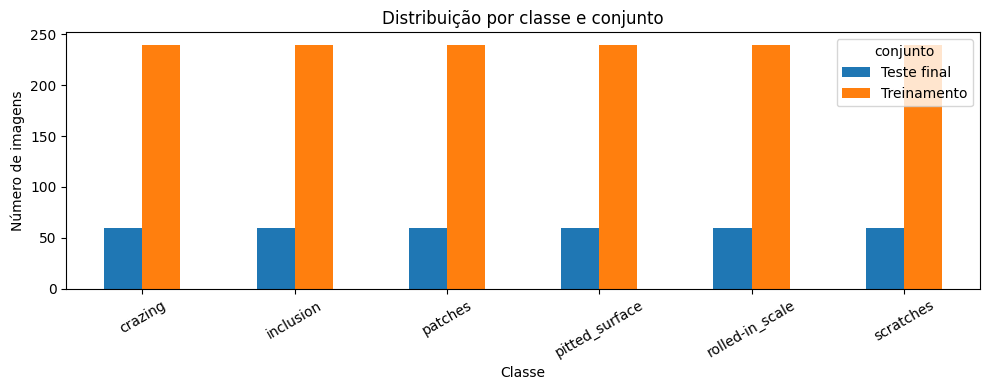
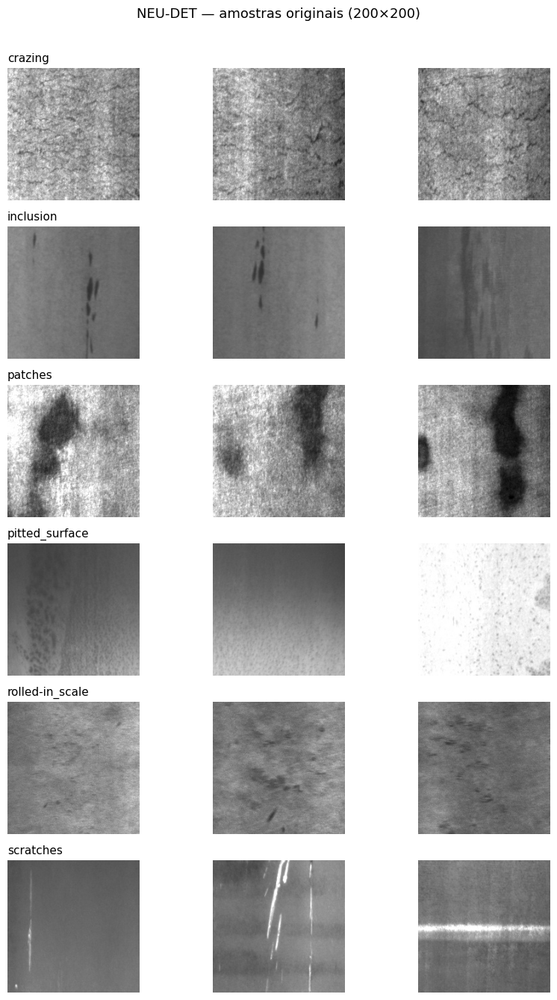
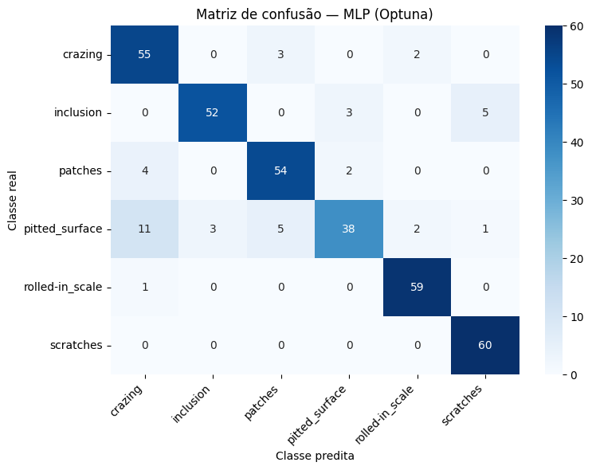
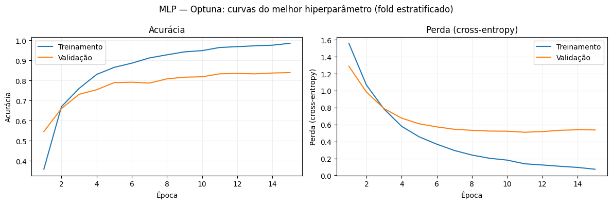

# NEU — Classificação de defeitos em superfícies de aço

[← Visão geral](../README.md) · [Metodologia e métricas](04-metodologia.md) · [Notebook executado](../notebooks/NEU_classificacao.ipynb)

**Problema:** classificação de seis tipos de defeito a partir de imagens de textura completas. Resultados são do notebook final executado; não foi realizado novo treinamento para esta documentação.

## 1. Contexto e análise exploratória

O **NEU Surface Defect Database** representa um problema de inspeção de qualidade em aço laminado a quente. São **1.800 imagens** em tons de cinza, originalmente de **200 × 200 pixels**, divididas igualmente em seis classes: *crazing*, *inclusion*, *patches*, *pitted surface*, *rolled-in scale* e *scratches*. Diferentemente da placa eletrônica, o desafio central é a **textura**: algumas classes compartilham padrões visuais próximos, sem uma forma geométrica simples e estável.

O notebook carrega **1.440 imagens de treino (240 por classe)** e reserva **360 da pasta `validation/images` (60 por classe)** exclusivamente para o **teste final**. A pasta se chama `validation` no dataset, mas, **no experimento**, não é utilizada para escolher hiperparâmetros. A validação para GS e Optuna ocorre dentro do treino por `StratifiedKFold` com três folds. Há uma verificação por SHA-256 que não encontrou **arquivos exatamente idênticos** entre treino e teste; isso não comprova ausência de todas as semelhanças visuais ou de possíveis origens comuns.

*Figura 5. Balanceamento exato: 240 imagens de treino e 60 de teste em cada uma das seis classes.*

*Figura 6. Exemplos da variedade de texturas no NEU; a semelhança entre padrões superficiais ajuda a explicar a dificuldade de algumas classes.*

Como a base é balanceada, a **acurácia**, o **recall macro** e o **F1 macro** podem ser comparados sem o forte viés que haveria se uma classe dominasse o dataset. Ainda assim, o F1 macro por classe é indispensável: reconhecer bem riscos não garante reconhecer bem corrosões, inclusões ou superfícies com pequenas cavidades.

## 2. Pré-processamento e arquitetura

Todas as imagens são convertidas em escala de cinza, redimensionadas para **64 × 64** e normalizadas por 255. Os tensores fornecidos à CNN têm forma `(1440, 64, 64, 1)` no treino e `(360, 64, 64, 1)` no teste. Para os classificadores baseados em HOG são obtidas matrizes de **288 atributos por imagem**. `StandardScaler` é ajustado dentro dos pipelines apropriados (MLP/SVM), somente nas partições de treinamento de cada fold.

A **CNN** conserva as duas convoluções, pooling, camadas densas e saída *softmax* para seis categorias. A **MLP** implementada em Keras usa HOG como entrada. A AD aprende cortes nos atributos, o Random Forest combina várias dessas estruturas, o SVM busca uma fronteira de separação em um espaço transformado e o GaussianNB calcula probabilidades a partir de distribuições estimadas por classe.

Essa escolha de resolução é uma decisão de custo-benefício: reduzir de 200 para 64 pixels diminui o custo, mas pode perder detalhes texturais. O experimento não compara formalmente várias resoluções; por isso, não é possível afirmar que 64 × 64 seja a melhor opção possível.

## 3. Busca de hiperparâmetros — o quadro que explica a seleção

| Algoritmo | GS: acurácia CV | Tempo GS (min) | Optuna: acurácia CV | Tempo Optuna (min) | Selecionado |
|---|---:|---:|---:|---:|---|
| CNN | 90,21% | 63,34 | 84,79% | 76,34 | GridSearchCV |
| MLP | 86,11% | 1,75 | 87,01% | 3,64 | Optuna |
| RF | 86,18% | 2,34 | 86,18% | 10,17 | GridSearchCV |
| AD | 61,94% | 0,70 | 61,60% | 1,10 | GridSearchCV |
| SVM | 87,78% | 0,07 | 87,36% | 1,05 | GridSearchCV |
| NB | 81,67% | ~0 | 81,67% | 1,06 | GridSearchCV |

A **CNN por GS** obteve maior acurácia na validação e custo menor do que o Optuna nessa execução, mas isso não significa que sua generalização final foi superior. Para a **MLP**, o Optuna encontrou o melhor resultado de validação (87,01%) e foi escolhido apesar de demorar mais que o GS. **RF, SVM e NB** tiveram desempenho de CV igual ou muito próximo entre métodos, favorecendo GS pelo tempo no experimento. A busca da **Árvore de Decisão** permaneceu substancialmente abaixo dos modelos mais competitivos.

A tabela demonstra uma diferença importante entre **seleção de hiperparâmetros** e **resultado de teste**: a ferramenta otimiza uma estimativa baseada em dados de treinamento/validação, mas o conjunto final pode revelar dificuldades que não apareceram com a mesma intensidade nos folds.

## 4. Desempenho em 360 imagens não usadas na busca (teste)

| Modelo escolhido | Acurácia teste | Precisão macro | Recall macro | F1 macro |
|---|---:|---:|---:|---:|
| MLP · Optuna | **88,33%** | **88,67%** | **88,33%** | **87,98%** |
| SVM · GS | 87,50% | 87,75% | 87,50% | 87,06% |
| RF · GS | 84,44% | 84,14% | 84,44% | 84,06% |
| NB · GS | 83,61% | 83,28% | 83,61% | 82,93% |
| CNN · GS | 78,89% | 80,72% | 78,89% | 77,23% |
| AD · GS | 58,06% | 58,17% | 58,06% | 57,64% |

*Figura 7. Matriz de confusão da MLP selecionada via Optuna; as 360 observações permitem avaliar o desempenho individual das seis texturas.*

A **MLP** lidera o teste, mas com vantagem pequena sobre o **SVM: 0,83 ponto percentual**. Com apenas 360 imagens, essa diferença corresponde a aproximadamente três acertos. Sem intervalos de confiança, reamostragens ou repetições com diferentes sementes, não cabe declarar superioridade estatística robusta. O resultado observado mostra apenas que essa MLP foi a mais acertiva **nessa execução e nesse conjunto de teste**.

A análise por classe mostra nuances. Na MLP, *scratches* obteve **F1 de 0,95**, *rolled-in scale* **0,96**, mas *pitted surface* apenas **0,74**, com **recall de 0,63**. Em outras palavras, a rede identificou muito bem riscos e escamas, mas deixou de recuperar parte importante das superfícies com cavidades. Esse resultado é coerente com a dificuldade de distinguir texturas mais sutis, mas não demonstra isoladamente uma causa física específica.

*Figura 8. Acurácia e perda em treinamento e validação, geradas por um novo ajuste diagnóstico do modelo selecionado (não pelo treino final de todos os dados).* 

### O resultado mais instrutivo: a CNN liderou na CV, mas caiu no teste

A CNN obteve **90,21% de acurácia média CV**, mas apenas **78,89% no teste final**: uma diferença de **11,32 pontos percentuais**. Entre as seis classes, sua matriz registra *scratches* com **recall de 0,42** e F1 de **0,57**, apesar de *crazing*, *patches* e *rolled-in scale* apresentarem recall próximo ou igual a 1,00.

Essa diferença sugere uma **fragilidade de generalização** para algumas texturas e/ou diferenças de composição entre treino e teste. Não basta mostrar que a curva de treino converge; é preciso examinar os erros de classe. Possíveis hipóteses incluem redução excessiva da resolução, diferenças visuais entre partições ou ajustes insuficientes do espaço CNN. Essas hipóteses exigem novos experimentos e não devem ser apresentadas como causas já comprovadas.

### Conclusão

A arquitetura mais sofisticada nem sempre vence. Em um conjunto relativamente pequeno, um bom descritor de textura HOG associado a uma **MLP** ou a um **SVM** pode competir com uma CNN treinada diretamente a partir dos pixels. A combinação que funcionou melhor no PCB não foi automaticamente a melhor no aço laminado: **a natureza visual do defeito e a estabilidade da generalização importam**.

---

---

## Configurações vencedoras selecionadas na validação

| Algoritmo | Estratégia escolhida | Estrutura e principais hiperparâmetros |
|---|---|---|
| CNN | GridSearchCV | Conv2D(32) → MaxPooling → Conv2D(64) → MaxPooling → Flatten → Dense(128) → Softmax(6); `padding=valid`, `stride=1`, `lr=0.001`, `batch_size=16`, 10 épocas |
| MLP | Optuna | HOG(288) → Dense(128) × 3 → Softmax(6), ReLU, dropout ≈0.044 por camada, `lr≈0.000286`, `batch_size=32`, 15 épocas |
| Random Forest | GridSearchCV | 200 árvores, profundidade livre, `min_samples_split=5`, `max_features=sqrt` |
| Árvore de Decisão | GridSearchCV | Critério entropia, `max_depth=10`, `min_samples_split=2`, `min_samples_leaf=1` |
| SVM | GridSearchCV | Kernel RBF, `C=1`, `gamma=scale` |
| GaussianNB | GridSearchCV | `var_smoothing=1e-11` |

> A CNN foi a melhor no CV (90,21%), mas registrou 78,89% no teste. O melhor desempenho final foi da MLP (88,33%). Essa divergência não deve ser apagada da interpretação metodológica.

## Como reproduzir

Execute [`notebooks/NEU_classificacao.ipynb`](../notebooks/NEU_classificacao.ipynb). O código usa `kagglehub` com o dataset `kaustubhdikshit/neu-surface-defect-database`; a pasta de validação disponibilizada pelo dataset é reservada como teste final neste experimento.
