# NASA FD001 — Predição da vida útil remanescente (RUL)

[← Visão geral](../README.md) · [Metodologia e métricas](04-metodologia.md) · [Notebook executado](../notebooks/NASA_FD001_regressao.ipynb)

*Um estudo de regressão temporal com NASA C-MAPSS FD001: sensores, janelas de ciclos, redes recorrentes, poda Hyperband, avaliação assimétrica e interpretação dos erros.*

**Contexto.** Segunda Verificação Parcial de Aprendizado de Máquina, PPGEP/UFPE, 2026.2. Este texto tem como fonte direta o notebook [`NASA_FD001_regressao.ipynb`](../notebooks/NASA_FD001_regressao.ipynb) e segue as exigências do documento disponibilizado pelo professor, fundamentadas em Saxena et al. (2008) e Heimes (2008).

> **Em síntese:** a LSTM escolhida por Optuna TPE + Hyperband produziu **RMSE de 14,52 ciclos**, **MAE de 10,77 ciclos** e **NASA Score de 354,71** sobre **100 motores oficiais de teste**. A análise por faixa de vida útil mostra que os erros foram muito menores perto da falha do que nas trajetórias ainda distantes do limite operacional.

Este artigo apresenta as seis etapas do enunciado: EDA de ciclos e sensores; pré-processamento sem vazamento; arquitetura recorrente; treinamento com callbacks; ajuste de hiperparâmetros com pruning; e validação em motores inéditos. O objetivo é compreender tanto os acertos quanto as limitações do modelo, não apenas reportar um RMSE.

## Introdução — De inspeção a prognóstico

## 1. O que muda quando o alvo deixa de ser uma classe?

Na inspeção de imagens, a pergunta é: *qual defeito aparece?* No FD001, a pergunta se torna: **quantos ciclos restam até o motor atingir o limite de falha simulado?** A resposta é numérica, contínua e dependente da história recente de funcionamento. Esse é um problema de **regressão de séries temporais**, não de classificação.

O C-MAPSS (*Commercial Modular Aero-Propulsion System Simulation*) simula o comportamento termodinâmico de motores turbofan. Um **ciclo** corresponde a uma observação sequencial associada à operação/voo simulado, e não a uma rotação do eixo. Um **sensor** é uma variável numérica que representa uma grandeza observável — temperatura, pressão, velocidade, fluxo etc. — calculada pelo simulador. Cada linha contém `unit_id`, `cycle`, três condições operacionais e 21 leituras de sensores. A degradação é induzida no modelo por mudanças de eficiência e capacidade de fluxo no **compressor de alta pressão (HPC)**. As leituras resultantes não precisam seguir, individualmente, trajetórias exponenciais simples: combinam dinâmica termodinâmica e ruído, conforme descrito por Saxena et al (2008).

## 2. EDA dos motores: trajetórias, ciclos e sensores

O FD001 apresenta **100 motores de treinamento (20.631 linhas)**, com trajetórias completas até a falha, e **100 motores oficiais de teste (13.096 linhas)**, observados apenas até um ciclo anterior à falha. O arquivo `RUL_FD001.txt` fornece um RUL verdadeiro **por motor de teste**. Nos dados de treino, as trajetórias duram de **128 a 362 ciclos**, média de **206,31** e desvio-padrão de **46,34** ciclos.

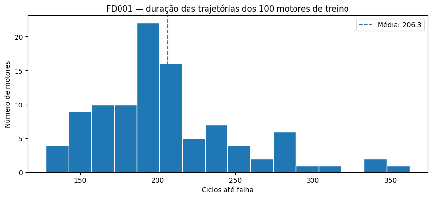

*Figura 1. Distribuição dos comprimentos completos dos 100 motores de treinamento. A variação entre motores impede tratar todos como uma única trajetória padrão.*

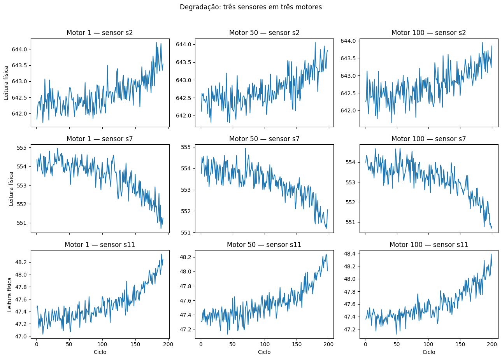

*Figura 2. Evolução de `s2`, `s7` e `s11` nos motores 1, 50 e 100, permitindo reconhecer tendências, dispersão e diferenças entre trajetórias.*

O notebook identifica **seis sensores rigorosamente constantes** (`s1`, `s5`, `s10`, `s16`, `s18`, `s19`) e um **quase constante** (`s6`, oscilando entre 21,60 e 21,61; variância aproximada de 1,93×10⁻⁶). Embora o enunciado simplifique essa etapa como remoção de sete sensores de variância zero, a implementação final justifica corretamente a remoção de **seis constantes e um quase constante**. Permanecem 14 sensores: `s2`, `s3`, `s4`, `s7`, `s8`, `s9`, `s11`, `s12`, `s13`, `s14`, `s15`, `s17`, `s20`, `s21`.

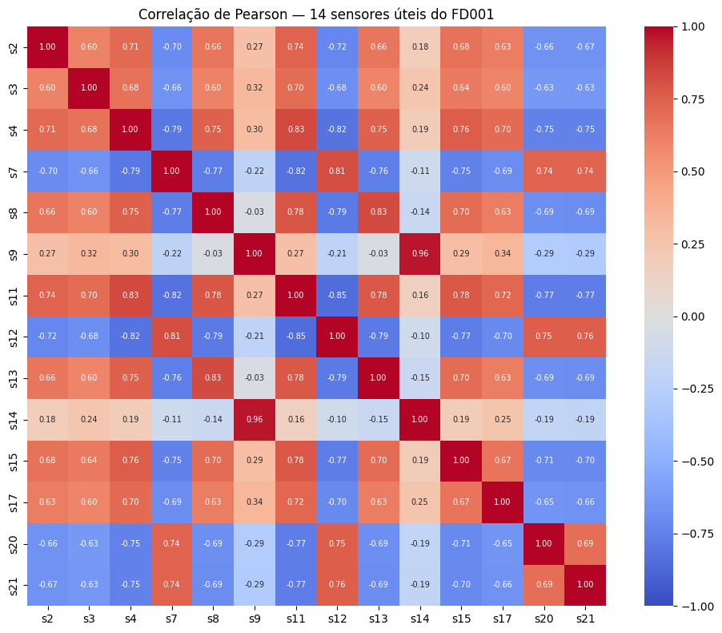

*Figura 3. Correlação de Pearson entre os 14 sensores retidos. Associações entre grandezas de temperatura, pressão, rotação e fluxo indicam redundâncias e relações físicas.*

## 3. Pré-processamento

O treinamento usa **80 motores**, e a validação usa **20 motores diferentes**. A separação ocorre **antes da normalização**. Um `MinMaxScaler` é ajustado exclusivamente nas **16.561 linhas dos 80 motores de treino**; suas transformações são aplicadas às **4.070 linhas dos 20 motores de validação** e às linhas dos 100 motores oficiais de teste. Ajustar os mínimos e máximos com validação ou teste anteciparia informação indisponível na implantação real e criaria *data leakage*.

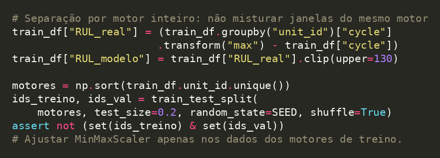

*Código 2. Separação por unidade antes do ajuste do scaler; evita que janelas de um mesmo motor apareçam simultaneamente em treinamento e validação.*

Para cada ciclo de cada motor de treinamento, calcula-se o RUL: `RUL(t) = ciclo_falha − t`. O alvo de aprendizado é limitado a **130 ciclos**, por `min(RUL,130)`, conforme a estratégia *piece-wise linear* discutida por Heimes (2008). A justificativa é que, no começo da vida, os sinais podem não permitir distinguir com precisão um motor com 200 ciclos restantes de outro com 300. **O RUL verdadeiro de teste não sofre esse clipping.**

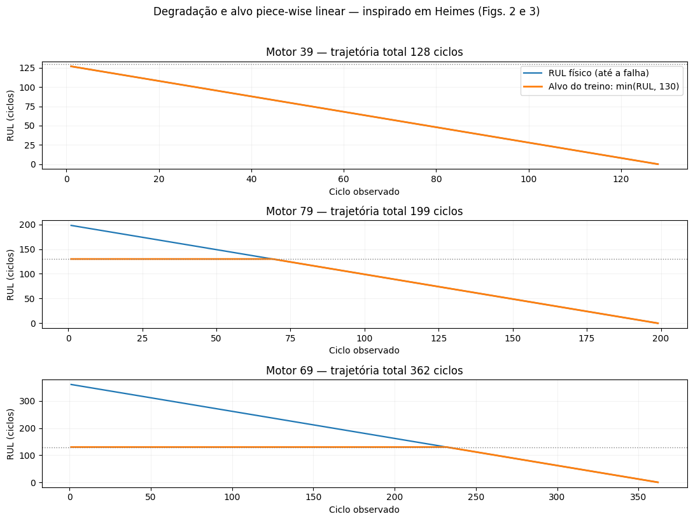

*Figura 4. Trajetórias de RUL original e limitado a 130 em motores de treinamento. O patamar é uma decisão sobre o alvo usado no aprendizado, não uma alteração da verdade de teste.*

A RNN recebe janelas deslizantes com passo 1. Com `W=50`, uma amostra tem formato **(50 ciclos, 14 sensores)**. No treinamento são possíveis múltiplas janelas por motor, cada uma rotulada pelo RUL do **último ciclo** da janela. No teste oficial, é produzida apenas **uma janela final por motor**, gerando 100 previsões. Quando a trajetória disponível tem menos que W ciclos, o código repete a primeira leitura observada para completar a janela — uma escolha operacional que evita descartar motores curtos, mas que merece estudo de sensibilidade.

## 4. Por que RNN, LSTM e GRU?

Uma **SimpleRNN** possui estado recorrente e propaga informações de passos anteriores, mas pode sofrer dificuldade em preservar dependências longas. A **LSTM** usa mecanismos de portas e estado de célula para reter e esquecer informação, enquanto a **GRU** apresenta um esquema de portas mais enxuto. Nenhuma delas transforma a tarefa em classificação: todas terminam em **`Dense(1, activation='linear')`**, que retorna um número de ciclos. O treinamento usa perda **MSE — erro quadrático médio** e otimização **Adam**; camadas densas ReLU e `Dropout` compõem a representação final e a regularização.

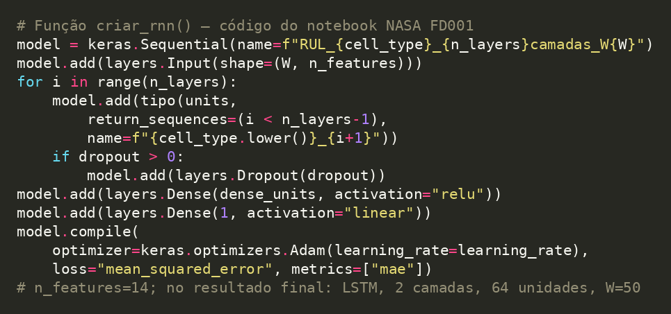

*Código 1. Trecho condensado de `criar_rnn()`: o parâmetro `return_sequences` preserva sequências nas camadas intermediárias, e a saída `Dense(1, linear)` representa uma previsão contínua em ciclos.*

No notebook, a arquitetura inicial de referência é uma **LSTM com 64 unidades**, uma camada recorrente, `Dense(32, ReLU)`, dropout 0,20, `learning_rate=0,001` e janela `W=30`, com **22.337 parâmetros treináveis**. Os callbacks `EarlyStopping` (`val_loss`, paciência de 12 épocas, restauração dos melhores pesos), `ReduceLROnPlateau` e `ModelCheckpoint` diminuem treinamento improdutivo, ajustam a taxa de aprendizagem e salvam o melhor modelo.

### Como ler a curva de perda?

**MSE** mede a erro quadrático médio entre RUL previsto e real; sua unidade é **ciclos²**. Reduzir a curva de treino indica ajuste crescente às janelas observadas; melhorar `val_loss` sugere generalização para motores não usados no ajuste. Se a curva de treino cai mas a validação piora de forma persistente, há sinal de possível *overfitting*. As curvas, contudo, não substituem a avaliação final em motores inéditos.

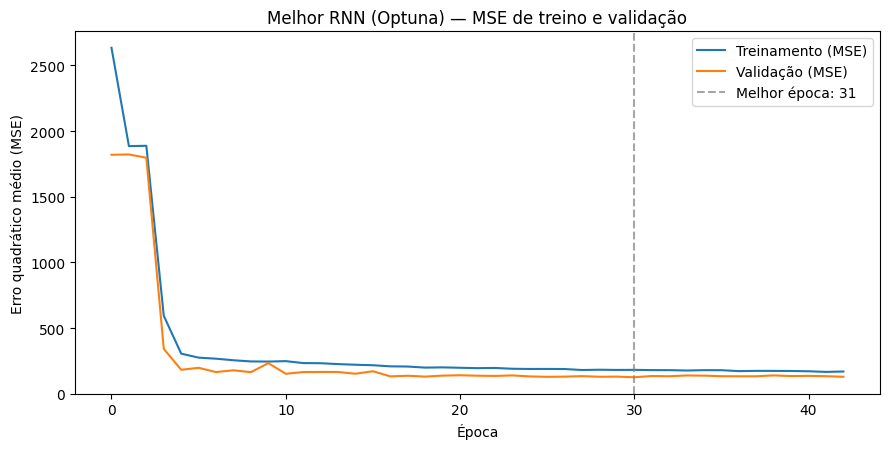

*Figura 5. Evolução do MSE na LSTM selecionada. O modelo foi reajustado após a busca e obteve RMSE de validação de 11,18 ciclos no ajuste final.*

## 5. Optuna com TPE e Hyperband: busca e poda por época

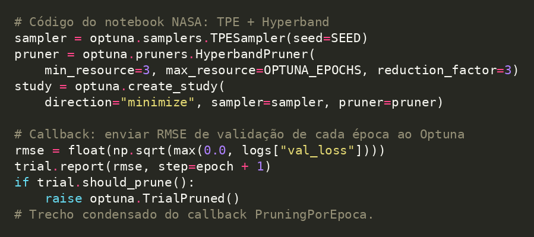

*Código 3. TPE propõe hiperparâmetros; Hyperband decide interromper trials a partir do RMSE reportado a cada época.*

Ao contrário dos dois casos de classificação, este experimento segue a exigência explícita de combinar **`TPESampler` e `HyperbandPruner`**. Foram testados tipo de célula (*SimpleRNN*, *LSTM*, *GRU*), quantidade de camadas recorrentes (1–3), unidades, dropout, taxa de aprendizagem, tamanho da janela W (20, 30, 40 ou 50), tamanho da camada densa e `batch_size`. A métrica objetivo é o **RMSE de validação**, que deve ser **minimizado**.

O estudo executou **20 trials**, dos quais **8 foram concluídos e 12 interrompidos antecipadamente por poda**. A busca consumiu **98,33 minutos**. O melhor trial apresentou **RMSE de validação de 10,8555 ciclos**, ante aproximadamente **12,3173 ciclos** da LSTM de referência: melhoria relativa de cerca de **11,9% no RMSE de validação**. É uma comparação interna em validação, não uma melhora medida no conjunto de teste.

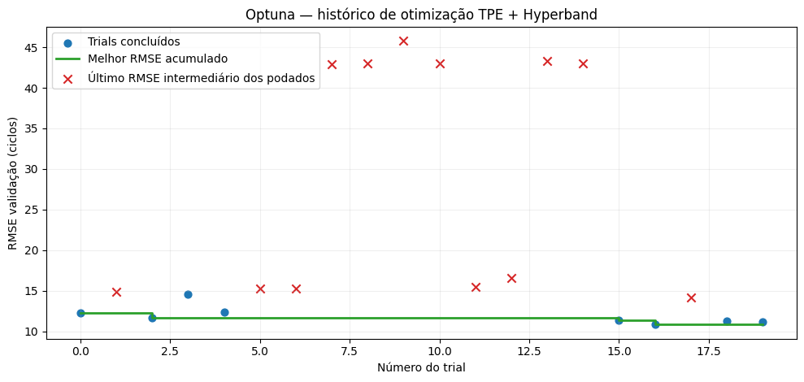

*Figura 6. Histórico dos trials concluídos e podados durante a busca TPE + Hyperband. A poda economiza avaliações de candidatos que demonstram desempenho inicial pouco promissor.*

| Escolha otimizada | Valor selecionado |
|---|---|
| Tipo de célula | **LSTM** |
| Camadas recorrentes | **2** |
| Neurônios por camada | **64** |
| Dropout | **0,40** |
| Janela temporal | **50 ciclos** |
| Camada densa | **32 unidades** |
| `batch_size` | **32** |
| `learning_rate` | **0,0013015** |
| Parâmetros treináveis no modelo final | **55.361** |

A preferência encontrada por uma LSTM com duas camadas e janela de 50 ciclos é **resultado desta busca limitada**. Não prova que arquiteturas GRU ou SimpleRNN sejam inferiores em todos os regimes, nem que W=50 seja ótimo em qualquer distribuição. A importância de hiperparâmetros calculada pelo Optuna é descritiva da região explorada e depende de poucos trials concluídos; não deve ser interpretada causalmente.

## 6. Métricas adequadas a regressão: RMSE, MAE e NASA Score

**MAE** é Erro Médio Absoluto: `MAE = média(|RUL_pred − RUL_real|)`. Sua unidade é ciclo, o que facilita interpretar o erro típico. **RMSE** é a Raiz do Erro Quadrático Médio: `RMSE = sqrt(média((RUL_pred − RUL_real)²))`. Também expresso em ciclos, dá peso maior a erros muito grandes. É essencial calcular ambos nos **100 motores de teste**, e não em janelas selecionadas apenas porque apresentam bom ajuste.

O **NASA Score** é assimétrico. Conforme a fórmula especificada pelo guia, define-se `d = RUL_previsto − RUL_real`; para `d < 0` a penalidade é `exp(−d/10) − 1`, e para `d ≥ 0` é `exp(d/13) − 1`, somando os 100 termos. **Menor é melhor.** A interpretação do sinal precisa acompanhar a fórmula: com esses denominadores e essa definição de d, **subestimativas negativas de mesma magnitude são penalizadas mais fortemente** do que superestimativas positivas. Essa consequência algébrica deve ser indicada, inclusive porque certas explicações intuitivas de risco operacional sugeririam a assimetria contrária.

**Resultado efetivamente registrado no teste FD001:**

| Indicador oficial | Resultado |
|---|---:|
| Motores avaliados | **100** |
| RMSE | **14,5169 ciclos** |
| MAE | **10,7685 ciclos** |
| NASA Score (fórmula do guia) | **354,7062** |
| Motores com RUL subestimado | **43** |
| Motores com RUL superestimado | **57** |

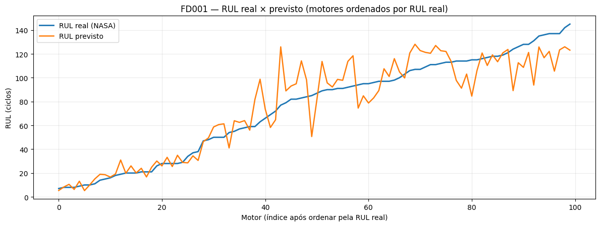

*Figura 7. Previsões ordenadas pelo RUL real de todos os 100 motores. Os desvios mais intensos aparecem em parte dos motores de maior RUL.*

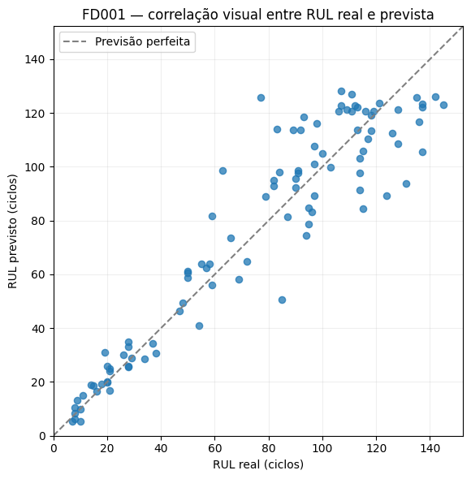

*Figura 8. Dispersão entre RUL real e previsto, com a diagonal representando previsão perfeita. A distância à diagonal traduz a magnitude do erro.*

### Em quais motores o modelo errou mais?

A análise posterior à avaliação agrupa os 100 motores por faixa de RUL verdadeiro. Ela responde uma pergunta mais útil para manutenção que um único RMSE agregado: **em qual fase de vida o sistema perde precisão?**

| RUL real | Número de motores | MAE (ciclos) | Viés médio (previsto − real) |
|---|---:|---:|---:|
| Até 30 | 25 | **3,19** | +1,82 |
| 31–80 | 20 | 11,38 | +6,37 |
| 81–130 | 47 | 12,89 | +0,77 |
| Acima de 130 | 8 | **20,44** | **−20,44** |

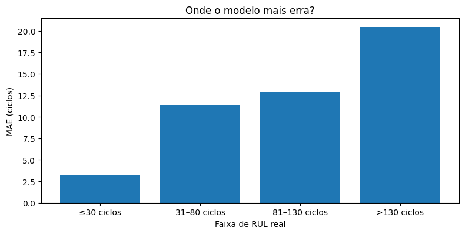

*Figura 9. Erro absoluto médio por faixa. O modelo foi mais preciso perto da falha e mais impreciso para motores com muito tempo restante.*

O contraste é expressivo: para motores próximos da falha (até 30 ciclos), o MAE foi **3,19 ciclos**, enquanto acima de 130 ciclos chegou a **20,44**. O viés de −20,44 nessa última faixa indica **subestimação sistemática no pequeno grupo de oito motores**. Isso é compatível com o teto de 130 usado no treinamento, mas outros fatores podem contribuir; não é prova causal do efeito do clipping. O maior erro absoluto individual ocorreu no motor **67**: RUL real de **77 ciclos**, estimativa de **125,89** (erro positivo de **48,89**). No motor **73**, o modelo previu **93,82** contra **131** reais (erro de **−37,18**).

No NASA Score registrado, as **43 subestimativas** somaram aproximadamente **224,17 pontos de penalização**, enquanto as **57 superestimativas** somaram **130,54**. Esses valores ilustram o efeito da função assimétrica escolhida: quantidade de erros em uma direção não basta para prever sua contribuição à pontuação; importa também sua magnitude.

### Conclusão

A rede não prevê o momento exato de uma falha física observada em campo, mas o **limite de falha operacional simulado** no C-MAPSS. Ela aprende padrões de degradação em motores de treinamento e generaliza para motores independentes de teste. Os resultados indicam capacidade de previsão particularmente útil **perto do fim de vida**, mas exibem incerteza maior em estágios iniciais, quando os sinais ainda distinguem pouco motores com vidas remanescentes diferentes.

A tarefa mudou de reconhecer classes para inferir uma quantidade: o número de ciclos até o limite de falha simulado. A LSTM com duas camadas e uma janela de 50 ciclos produziu RMSE de **14,52** e MAE de **10,77 ciclos** no teste oficial, mas a utilidade desse resultado depende do estágio da trajetória. Motores muito próximos da falha apresentaram os menores erros; os oito motores acima de 130 ciclos tiveram MAE bem maior. O clipping do alvo é uma justificativa plausível, porém outros fatores precisam de validação experimental.

O modelo também é restrito a um cenário simulado (FD001, uma condição principal e um modo de falha no HPC). Um estudo mais próximo do uso industrial exigiria repetição com diferentes sementes, análise de incerteza, validação em FD002–FD004 e testes com condições operacionais não vistas. O arquivo `.keras` salvo não basta isoladamente para inferência: devem ser guardados também a ordem dos sensores, o `MinMaxScaler` e a janela temporal.

## Referências

- [`NASA_FD001_regressao.ipynb`](../notebooks/NASA_FD001_regressao.ipynb) — código, históricos, métricas e figuras do experimento.
- Saxena, A., Goebel, K., Simon, D. & Eklund, N. (2008). *Damage Propagation Modeling for Aircraft Engine Run-to-Failure Simulation*. DOI: 10.1109/PHM.2008.4711414.
- Heimes, F. O. (2008). *Recurrent Neural Networks for Remaining Useful Life Estimation*. PHM 2008.
- NASA Prognostics Center of Excellence. *C-MAPSS Dataset*. https://ti.arc.nasa.gov/tech/dash/groups/pcoe/prognostic-data-repository/

*Nota: resultados extraídos da execução registrada no notebook fornecido; não houve novos treinamentos para a redação do texto.*

## Reproduzir o estudo

O [notebook NASA](../notebooks/NASA_FD001_regressao.ipynb) procura os arquivos `train_FD001.txt`, `test_FD001.txt` e `RUL_FD001.txt` em locais conhecidos e dispõe de uma opção de download. A reprodução integral pode exigir TensorFlow, tempo de execução considerável e configuração do ambiente Kaggle/Colab. O repositório traz os **resultados originais documentados**, não um novo treinamento.
