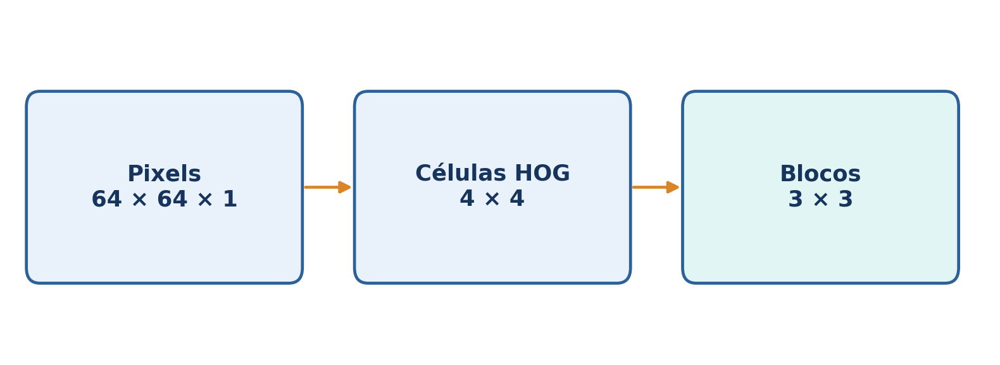
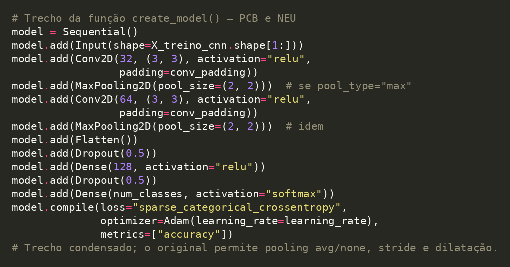
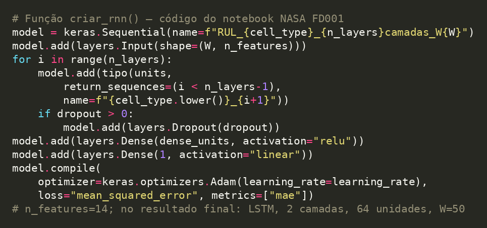

# Metodologia compartilhada, arquiteturas e interpretação das métricas

[← Visão geral](../README.md) · [PCB](01-pcb.md) · [NEU](02-neu.md) · [NASA](03-nasa-fd001.md)

Este documento explica o vocabulário técnico necessário para compreender os três notebooks. As **configurações finais e os resultados empíricos** encontram-se nos relatórios específicos.

## 1. Dados de entrada: tensor de pixels versus HOG

Para a CNN de classificação, cada imagem é redimensionada a **64 × 64 pixels em tons de cinza** e fornecida no formato **`(64, 64, 1)`**. O último valor é o número de canais. Esse tensor preserva a vizinhança espacial entre pixels, permitindo aprender filtros de bordas e textura.

Nos modelos MLP, SVM, Random Forest, Árvore de Decisão e Gaussian Naive Bayes, o **HOG (Histogram of Oriented Gradients)** transforma a imagem em um vetor de **288 características**. Os números descrevem a distribuição local de gradientes; não são os 4.096 pixels brutos.



### Como se chega aos 288 valores?

1. Uma imagem `64 × 64` com `pixels_per_cell=(16,16)` contém **4 × 4 células**.
2. O HOG analisa o gradiente — variação de intensidade — em **8 faixas de orientação**. Cada faixa agrega bordas apontadas para determinada direção, distribuindo orientações ao longo de 180° (ângulos de 22,5° em intervalos usuais de gradientes não assinados).
3. O parâmetro `cells_per_block=(2,2)` reúne quatro células vizinhas. Esse bloco pode começar em **3 posições horizontais e 3 verticais** dentro da grade de 4 × 4 células, totalizando **9 blocos sobrepostos**.
4. Cada bloco possui `2 × 2 × 8 = 32` componentes; os nove blocos geram **`9 × 32 = 288`** características. Blocos sobrepostos e normalizados reduzem sensibilidade a mudanças locais de iluminação/contraste.

Exemplo da configuração do extrator HOG (trecho didático equivalente):

```python
from skimage.feature import hog

vetor_hog = hog(
    imagem_cinza_64x64,
    orientations=8,
    pixels_per_cell=(16, 16),
    cells_per_block=(2, 2),
)
assert len(vetor_hog) == 288
```

## 2. CNN 2D supervisionada e suas camadas

A CNN empregada é **customizada, sequencial, rasa e voltada à classificação multiclasse**; não é ResNet, VGG, U-Net ou detector de objetos. A arquitetura base contém duas convoluções (32 e 64 filtros `3 × 3`), pooling ajustável, `Flatten`, `Dropout(0.5)`, `Dense(128, ReLU)` e `Dense(6, Softmax)`. O tipo de pooling selecionado difere: **AveragePooling no PCB e MaxPooling no NEU**.



| Conceito | Operação na rede | Implicação |
|---|---|---|
| Filtro `3 × 3` | Pequeno conjunto de pesos aprendido na convolução | Responde a padrões locais de borda, textura e forma |
| `Conv2D(32)` e `Conv2D(64)` | Conjuntos de 32 e 64 filtros treináveis | Produzem mapas de características distintos |
| `stride=1` | Filtro avança um pixel por vez | Preserva amostragem espacial mais detalhada |
| `padding='valid'` | Sem pixels artificiais nas bordas | Uma convolução `3×3` com stride 1 transforma `64×64` em `62×62` |
| `padding='same'` | Acrescenta preenchimento conforme necessário | Com stride 1, mantém altura e largura |
| MaxPooling `2×2` | Mantém o maior valor em uma região | Enfatiza ativações locais mais fortes |
| AveragePooling `2×2` | Mantém a média na região | Resume/suaviza as ativações locais |
| `Flatten` | Converte mapas em vetor | Permite entrada em camadas Dense |
| `Dense` | Combina todos os componentes da entrada por pesos | Realiza decisões sobre características extraídas |
| `ReLU` | Calcula `max(0,x)` | Introduz não linearidade |
| `Dropout(0.5)` | Zera aleatoriamente ativações durante treinamento | Regularização; 0,5 é proporção, não tempo |
| `Softmax` | Normaliza as seis saídas como probabilidades | A classe prevista corresponde à maior probabilidade |

A **sparse categorical crossentropy** usa classes inteiras (`0` a `5`) e penaliza probabilidades baixas atribuídas à classe correta. O algoritmo Adam atualiza os pesos conforme os gradientes da perda; `learning_rate=0.001` é a taxa de aprendizagem, não uma métrica.

## 3. Os seis classificadores

| Modelo | Ideia central | Entrada nos notebooks |
|---|---|---|
| CNN | Aprende filtros espaciais e classifica a partir de mapas convolucionais | Pixels `(64,64,1)` |
| MLP | Combina atributos por camadas densas não lineares | HOG 288, com `StandardScaler` |
| SVM | Busca fronteira de decisão com margem, podendo usar kernel RBF | HOG 288, com `StandardScaler` |
| Random Forest | Agrega votos de diversas árvores treinadas com aleatoriedade | HOG 288 |
| Árvore de Decisão | Divide repetidamente atributos de acordo com regras | HOG 288 |
| Gaussian Naive Bayes | Modela distribuição condicional dos atributos por classe, assumindo independência condicional | HOG 288 |

## 4. Validação, GridSearchCV e Optuna

**Fold** é um subconjunto usado temporariamente para validação. Em **3-fold CV**, cada configuração é treinada três vezes com revezamento da parcela validada; a métrica média ajuda a escolher hiperparâmetros. `GridSearchCV` testa todas as combinações de sua grade. Optuna com `TPESampler` sugere configurações adaptativamente; um **trial** é a avaliação de uma configuração. No PCB, o agrupamento com `StratifiedGroupKFold` evita que recortes da mesma imagem de origem apareçam em treino e validação. No NEU, `StratifiedKFold` preserva as proporções das classes.

**Diferença dos casos:** nos dois classificadores, o Optuna usa TPE **sem pruning**. No NASA, usa **TPE + HyperbandPruner**, com relato intermediário do RMSE por época.

## 5. Métricas de classificação

- **Accuracy:** número de acertos dividido pelo total.
- **Precision:** dentre os exemplos previstos como determinada classe, qual proporção era correta?
- **Recall:** dentre os exemplos realmente daquela classe, quantos foram reconhecidos?
- **F1-score:** média harmônica de precision e recall.
- **Macro:** média aritmética das métricas calculadas separadamente por classe, sem favorecer classes maiores.
- **Matriz de confusão:** linhas = classes reais; colunas = classes preditas. Diagonal = acertos; fora da diagonal = confusões.

## 6. Regressão temporal: LSTM, janelas W, TPE e Hyperband

O C-MAPSS FD001 registra medições de **14 sensores** por ciclo dos motores. Uma janela `W=50` reúne 50 ciclos consecutivos: a entrada tem forma `(50,14)`. A rede produz **uma previsão contínua** de RUL para o último ciclo. W=50 foi escolhido empiricamente pelo Optuna; não é uma constante física do motor.

A busca considera três **famílias de células recorrentes**, escolhidas como hiperparâmetro categórico: `SimpleRNN`, `GRU` ou `LSTM`. Não são três classificadores: cada configuração forma uma rede de **regressão** com saída `Dense(1, linear)`. O TPE utiliza resultados de trials anteriores para propor novas combinações. O Hyperband pode interromper trials cujo RMSE de validação intermediário não compense continuar gastando épocas.



| Tipo de célula | Mecanismo | Implicação |
|---|---|---|
| SimpleRNN | Estado oculto recursivo | Simplicidade; maior dificuldade potencial com dependências longas |
| GRU | Portas de atualização e reinicialização | Controle da memória com estrutura mais enxuta |
| LSTM | Portas de esquecimento, entrada e saída, além de estado de célula | Controle explícito da preservação da informação temporal |

O estudo realizou **20 trials; oito foram completos e 12 foram podados**. A menor RMSE de validação observada foi **10,8555 ciclos**, com **LSTM de duas camadas de 64 neurônios**, dropout de 0,40 e W=50. O resultado não prova superioridade universal da LSTM: a busca não destinou o mesmo orçamento completo a todas as arquiteturas.

**Callbacks:** `EarlyStopping` interrompe quando `val_loss` não melhora por certa paciência e pode restaurar os melhores pesos; `ReduceLROnPlateau` reduz a taxa de aprendizagem diante de estagnação; `ModelCheckpoint` salva a melhor versão do modelo. Eles não são equivalentes à poda Hyperband entre trials.

**Clipping do RUL:** no treinamento, o alvo é `min(RUL,130)`, que estabelece patamar inicial para trajetórias longas. Os RULs reais do teste não recebem esse clipping. A transformação é uma decisão metodológica, não prova de que a degradação começa fisicamente aos 130 ciclos restantes.

## 7. Métricas de regressão

- **MSE (*loss*):** Erro Quadrático Médio, em ciclos²; orienta o ajuste dos pesos.
- **MAE:** Erro Médio Absoluto, em ciclos; fácil de interpretar.
- **RMSE:** Raiz do Erro Quadrático Médio, em ciclos; penaliza mais erros grandes.
- **NASA Score:** soma de penalizações assimétricas segundo a fórmula prevista no guia da atividade; menor é melhor. A direção da assimetria depende da definição do erro e dos expoentes usados.

**Transparência:** todos os valores apresentados derivam das saídas presentes nos notebooks executados. Não houve reexecução nem auditoria independente do treinamento nesta adaptação ao GitHub.
